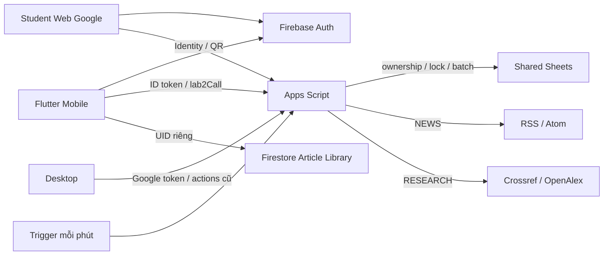
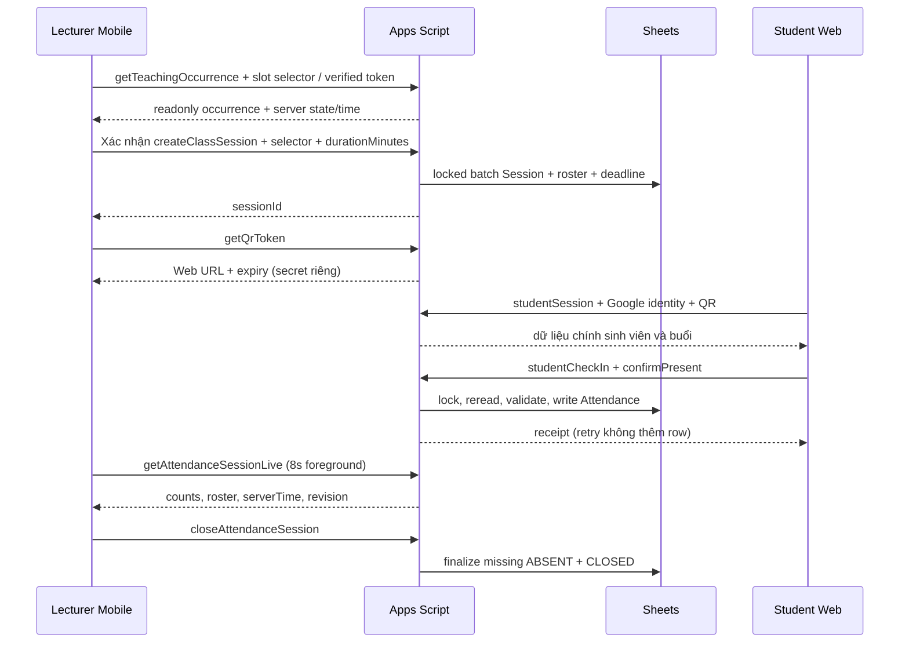

# Kiến trúc hiện hành — 11/10/2026

Mobile giảng viên, Desktop và Student Web đọc/ghi cùng workbook Sheets qua cùng Apps Script deployment. Source tại máy đã refactor; deployment thật cần migration theo [IMPLEMENTATION_REPORT](IMPLEMENTATION_REPORT.md). Mô tả cũ lưu trong [ARCHITECTURE_LEGACY](ARCHITECTURE_LEGACY.md).

## Client và dữ liệu

`main.dart` khởi động Firebase rồi `lab2/app.dart`: Riverpod/GoRouter, lecturer guard. `CampusRepository` chọn shared mode bằng config compile-time; `DesktopSync` gửi JSON, kiểm HTTPS endpoint/redirect, đọc `{ok,data,error}`, cache snapshot theo account. Sign-out đổi generation/clear cache. Full snapshot authorized thông thường30s; mutation refresh. Live/content read không kéo full snapshot.

UI: Hôm nay, Lịch dạy, Lớp học, Cập nhật. Lớp: Sinh viên, Điểm danh, Buổi học, Thống kê. Avatar mở tài khoản/công cụ import. OCR ML Kit tại máy; Excel/CSV preview/validation rồi gửi backend có quyền. Firestore chỉ thư viện `articleLibraries/{firebaseUid}/articles/{hash}`: owner verified email CRUD. Article cũ đọc được; contentType optional. Không mirror Students/Attendance vào Firestore.

## Luồng gọi backend

| Luồng | Caller → handler | Kiểm tra / dữ liệu |
|---|---|---|
| Bootstrap | DesktopSync → lab2Snapshot → lab2Handle_ | Firebase verified identity, map Lecturer, lớp thuộc quyền |
| Chi tiết buổi | getTeachingOccurrence → lab2OccurrenceView_ | Resolve Schedules + ScheduleExceptions, ownership, server state/time; reconcile expired, không tạo phiên |
| Tạo phiên | createClassSession / Desktop createSession → lab2CreateFromOccurrence_ | Authoritative occurrence/window, duration, ownership, lock; frozen roster/deadline; batch Sessions + Lab2SessionMeta; trùng OPEN trả phiên cũ |
| Live | getAttendanceSessionLive → lab2Live_ | Owner lớp, reconcile expired; roster phiên, counts, revision/timestamps; không token/secret |
| QR | getQrToken / rotateAttendanceQr | Owner, OPEN/deadline; secret tách URL; token TTL không kéo dài phiên |
| Student Google | studentSession / studentCheckIn → studentContext_ | Verified email duy nhất khớp roster, enrollment/frozen roster, token/secret/expiry; không trả cả lớp |
| Student ghi | handleStudentCheckIn_ | Verify trước lock, reread sau lock, batch Attendance; retry receipt gốc |
| Chốt | closeAttendanceSession / closeSession / trigger → lab2Finalize_ | Cùng lock; thêm ABSENT còn thiếu theo roster snapshot, CLOSED idempotent |
| Sửa điểm danh | updateAttendanceRecord / updateAttendance → lab2Correct_ | Owner, reason, bốn trạng thái; Attendance + AttendanceAudit atomic; server actor |
| Import | importTimetable / importClassStudents | Validate tất cả rows và quyền; upsert/idempotent; không xóa roster cũ |
| Ngoại lệ | saveScheduleException → lab2SaveException_ | schedule/date, owner, conflict; chặn nếu có session; Schedules nguyên bản |
| Sửa sinh viên | updateClassStudent → lab2UpdateStudent_ | Name/email whitelist; MSSV bất biến, email unique/domain; profile chung cần admin; RosterAudit |
| Cập nhật | getSubjectTopics / getSubjectUpdates | Môn từ Classes authoritative trước cache/network; filters/cursor/provenance |
| Bookmark | ArticleLibrary → Firestore SDK | Rules owner UID/verified email, optional validated contentType, legacy fields |

## Backend và tương thích

`Code.gs` giữ action/envelope Desktop; `Lab2Free.gs` nhận lab2Call/snapshot. `AttendanceSafety.gs`: correction/reconciliation/live dùng chung. `ClassTools.gs`: exception/roster. `SubjectInsights.gs`: pipeline feed độc lập attendance.

Cột/ID bảng Desktop nguyên bản. Additive tables: Lab2SessionMeta, AttendanceAudit, RosterAudit, ScheduleExceptions, SubjectContentConfig, ContentSourceRegistry, SubjectContentCache; cache/share article legacy giữ lại. Initializer chỉ thêm bảng/header thiếu và validate, không sửa header hoặc suy diễn roster lịch sử.

Writes: script lock + Advanced Sheets batch. Auth/source network ngoài write lock; trạng thái authoritative đọc lại trong lock. Trigger tối đa25 phiên/lần, scope script.scriptapp. Mobile và Desktop dùng cùng resolver occurrence. Mobile chọn 5/10/15/20/30 phút, Desktop mặc định 10 phút; opensAt là serverNow, closesAt không vượt scheduledEndAt. Chỉ mở trong ngày occurrence, từ 15 phút trước giờ học đến trước giờ kết thúc, còn ít nhất 1 phút; xử lý qua nửa đêm. Phiên cũ không metadata fallback thận trọng.

PRESENT/LATE/ABSENT/EXCUSED giữ raw semantics. Policy từ Script Properties; unknown không tự tính tỷ lệ liên quan. Thống kê finalized-only. Desktop FAP bridge từ chối EXCUSED chưa ánh xạ; chưa quyết định thay người phụ trách. Desktop calendar chưa render exceptions; backend vẫn chặn create/reset buổi hủy/dời.

## Subject Insights và hiệu năng

Authorization → subject config → allowlisted source registry → cache → normalized metadata → filters/cursor → UI. NEWS RSS/Atom; RESEARCH Crossref/OpenAlex. Dedupe DOI/URL hash; sanitize excerpt; source-date-topic provenance. Không scraper/full text/AI summary; không gửi dữ liệu người dùng đến nguồn công khai.

2 sources/call, timeout10s/source, 24 items/feed, <=45.000 ký tự, NEWS TTL6h/RESEARCH24h, cooldown120s, cap400 cache rows. Owner prune chỉ cache hết hạn >7 ngày. API không cho client bỏ cooldown. Nguồn lỗi có partial/stale, timestamp thật. Config version invalidates feed khi topic/source đổi.

Live foreground8s, lỗi backoff16..60s, pause background, stop CLOSED. QR/roster tách call. Response nhỏ hơn snapshot nhưng Sheets đọc bảng tuyến tính; phải đo workbook thật trước tuyên bố SLA. Client timeout35s không đảm bảo tổng auth/Sheet/network luôn hoàn tất.

## Chế độ phụ / giới hạn

Functions/emulator source giữ cho regression, không phải backend chính shared. Quiz tắt; Mobile không có student workspace. FAP bridge là luồng Desktop riêng, Mobile không tự gửi FAP.

Tests VM/widget/rules/emulator và APK được kiểm tại máy. Chưa có deployment refactor, real-account E2E/50 concurrent benchmark hay iOS device evidence. Xem báo cáo để biết checklist release.
