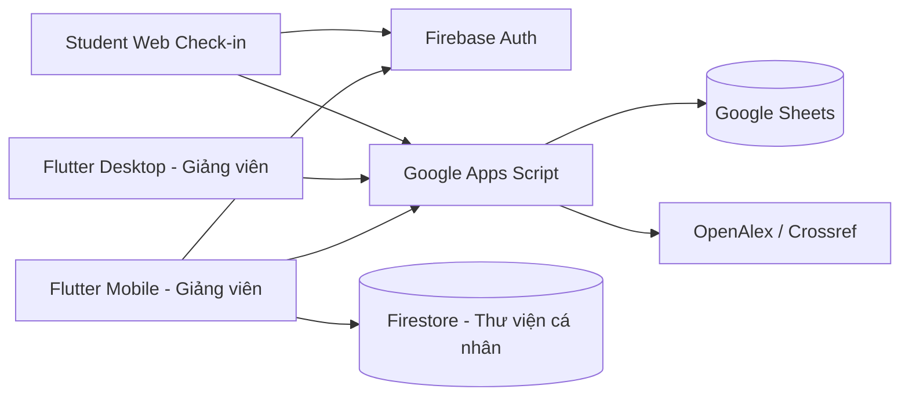
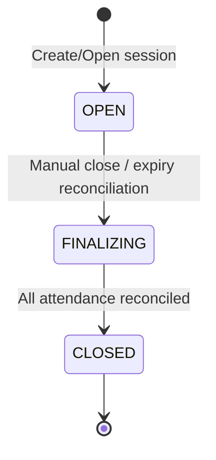
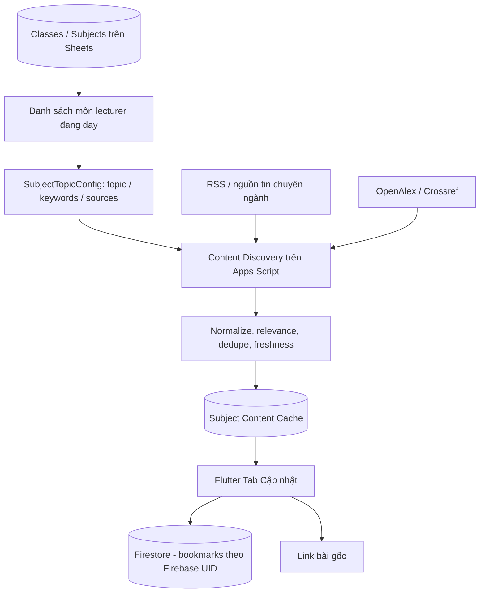

# FAP Attendance Mobile — Blueprint tái cấu trúc và phát triển cho Codex

> Source Mobile hiện hành 11/10/2026: Google-only, 4 tab Hôm nay/Lịch dạy/Lớp học/Cập nhật, phiên từ lịch với duration 5/10/15/20/30 phút và phòng hiệu lực. Xem [MOBILE_UI_UX_REDESIGN_REPORT](MOBILE_UI_UX_REDESIGN_REPORT.md). Mô tả email/password, form phiên thủ công và deployment cũ trong tài liệu này là lịch sử, không chứng minh source mới đã được triển khai cloud.

> **Mục đích:** Tài liệu đặc tả yêu cầu sản phẩm, kiến trúc, business rules, API và kế hoạch sửa mã nguồn **đang có** để biến ứng dụng thành **FAP Attendance – Smart Teaching Assistant (Lecturer Companion)**.
>
> **Đối tượng sử dụng:** Codex / AI coding agent trực tiếp làm việc trên repository.
>
> **Ngày soạn:** 11/10/2026  
> **Trạng thái:** Đặc tả mục tiêu, **chưa phải báo cáo xác minh mã nguồn**. Codex phải đọc code và đối chiếu trước khi sửa.

---

## 0. Lệnh triển khai dành cho Codex (đọc trước)

Bạn là **Senior Flutter Engineer + Backend Engineer + QA Reviewer**. Nhiệm vụ là **refactor có kiểm soát dự án hiện có**, không viết lại từ đầu. Ưu tiên: **tính đúng đắn điểm danh > bảo mật > giữ tương thích > trải nghiệm di động > tin tức theo môn > tính năng phụ**.

### Yêu cầu bắt buộc

1. **Audit repository trước khi sửa**: đọc cấu trúc, mô hình dữ liệu, Firebase Rules (nếu có), các action Apps Script, web check-in, luồng Desktop và toàn bộ test; lập bảng `đã có / thiếu / khác mô tả / rủi ro`.
2. **Không mặc định mọi file/hàm/API trong blueprint đều đã tồn tại.** Các API ghi `[PROPOSED]` là thiết kế đề xuất, phải cài đặt cả caller + handler + test nếu được chọn.
3. **Giữ nguyên đường chạy cũ trong giai đoạn chuyển tiếp:** Flutter Mobile ↔ Apps Script ↔ Google Sheets ↔ Desktop; Student Web dùng Apps Script + Firebase Authentication. Không tự ý đổi sang PostgreSQL, Firebase Functions hoặc thay backend chính.
4. Không xóa, đổi tên, thay schema, ghi đè dữ liệu hoặc phá hợp đồng các action đang dùng bởi Desktop/Web nếu chưa có **adapter/migration tương thích**.
5. Không thay thế cách xác thực giảng viên bằng điều kiện kiểm tra ở frontend. Quyền truy cập và sở hữu lớp phải được backend kiểm tra ở **mọi action**.
6. Không tự thêm tính năng ngoài phạm vi: AI tự sinh tóm tắt, Quiz/LMS, chat, student mobile app, đồng bộ tự động vào FAP, push notification phức tạp, đa cơ sở, thanh toán.
7. Không để dữ liệu mock/hardcoded hoặc timestamp giả trong production UI. Mock chỉ dùng fixture và test.
8. Mỗi giai đoạn: thay đổi nhỏ, chạy test, cập nhật tài liệu, báo cáo ảnh hưởng. Tránh refactor tràn lan không liên quan.
9. Khi không đủ thông tin về chính sách vắng có phép/đi trễ, **không tự đặt quy tắc quy đổi**. Cô lập ở cấu hình/policy và ghi rõ giả định an toàn.
10. Nếu không thể hoàn thành toàn bộ trong một lượt, ưu tiên hoàn thành **P0** và một lát cắt end-to-end của **Subject Insights**, sau đó liệt kê chính xác phần còn thiếu; không tuyên bố hoàn thành khi chưa chạy được.

### Kết quả kỳ vọng từ Codex

- Code Flutter/Apps Script/Student Web đã chỉnh, với migration additive khi cần.
- UI 4 tab rõ ràng; điểm danh trực tiếp và cập nhật tin tức theo môn hoạt động từ đầu đến cuối.
- Test tự động + hướng dẫn E2E/manual cho chức năng cần tài khoản thật.
- `docs/IMPLEMENTATION_REPORT.md`: những gì đã sửa, đường dẫn file, API/schema thêm mới, kết quả test, rủi ro chưa xử lý và cách cấu hình/deploy.
- `README.md` mô tả đúng hiện trạng, bỏ quảng bá chức năng không tồn tại.

---

## 1. Bối cảnh và baseline thực tế cần bảo tồn

**Mục tiêu sản phẩm:** Mobile cho **giảng viên**, giúp xem lịch dạy, quản lý lớp, điểm danh QR, sửa và thống kê chuyên cần, đồng thời tự động cập nhật **tin tức chuyên ngành và nghiên cứu khoa học gắn với các môn đang giảng dạy**. Sinh viên điểm danh trên **web sau khi quét QR**, **không có student role trong mobile**.

### 1.1 Kiến trúc hiện tại (theo mô tả đã cung cấp)



- Mobile và Desktop **không gọi nhau**; dùng chung dữ liệu từ Google Sheets qua Apps Script.
- Snapshot mobile: `lab2Snapshot` → token Firebase → kiểm tra quyền giảng viên → hồ sơ/lớp/lịch/điểm danh.
- Gọi nghiệp vụ: `lab2Call` với `{ idToken, name, input }`.
- Web sinh viên: `studentSessionInfo`, `studentCheckIn` (Google); `studentCodeSessionInfo`, `studentCodeCheckIn` (MSSV).
- Thư viện cá nhân tại `articleLibraries/{firebaseUid}/articles` trong Firestore (cần đối chiếu quyền truy cập thực tế).
- Ảnh thời khóa biểu OCR xử lý **local** bằng ML Kit; file sinh viên Excel/CSV được preview trước khi import.
- Google Sheets cache/snapshot khoảng 30 giây ở mobile; thống kê lịch sử dựa trên phiên đã chốt.
- Không có luồng tích hợp FAP chính thức tự động.
- Baseline được báo cáo: **74/74 Flutter tests, 35/35 backend/web tests pass**. `flutter analyze` **chưa xác nhận hoàn tất**; kiểm thử E2E với tài khoản thật chưa có.

### 1.2 Các khu vực mã được nhắc đến (kiểm tra đường dẫn thực tế)

- `lib/lab2/classes.dart`
- `lib/lab2/domain.dart`
- `lib/lab2/desktop_sync.dart`
- `lib/lab2/repository.dart`
- `lib/lab2/article_library.dart`
- `backend/apps_script/Lab2Free.gs`
- `web_checkin/public/checkin.js`
- Desktop có thể thuộc repo/thư mục riêng: **tìm điểm phụ thuộc API/schema thực sự, đừng giả định có source Desktop trong repo mobile**.

### 1.3 Hợp đồng action cũ cần bảo toàn

| Action | Ý nghĩa |
|---|---|
| `lab2Snapshot` | Snapshot dữ liệu lecturer |
| `lab2Call` | Dispatcher nghiệp vụ (không phải tên nghiệp vụ riêng) |
| `importTimetable` | Nhập thời khóa biểu |
| `importClassStudents` | Nhập roster |
| `createClassSession` | Tạo phiên theo Sheets |
| `openAttendanceSession` | Mở phiên có sẵn |
| `getQrToken` | Lấy QR/token |
| `rotateAttendanceQr` | Đổi QR / chế độ Secret Code |
| `updateAttendanceRecord` | Sửa điểm danh |
| `closeAttendanceSession` | Chốt phiên |
| `discoverArticles` | Tìm bài báo OpenAlex/Crossref |
| `studentSessionInfo`, `studentCheckIn` | Web Google check-in |
| `studentCodeSessionInfo`, `studentCodeCheckIn` | Web MSSV check-in (rủi ro; cần hardening) |

Kết quả backend cũ dạng `{ "ok": true, "data": ... }` hoặc `{ "ok": false, "error": ... }`. Hãy giữ envelope này hoặc bổ sung tương thích, không đổi đột ngột.

---

## 2. Product scope — giữ, đổi, loại

### 2.1 Phạm vi chính (MUST)

1. **Hôm nay:** lớp/buổi sắp dạy; hành động `Bắt đầu` hoặc `Tiếp tục điểm danh`; cảnh báo phiên và chuyên cần.
2. **Lịch dạy:** xem ngày/tuần, lọc học kỳ/môn, mở chi tiết buổi; hỗ trợ ngoại lệ lịch trong phase P1.
3. **Lớp học:** danh sách lớp, sinh viên, buổi học, điểm danh, thống kê; chỉnh thông tin được phân quyền.
4. **Cập nhật kiến thức (Subject Insights):** tự nhận biết môn đang dạy, news/research, lọc, mở bài gốc, lưu bài.
5. **Tài khoản/Công cụ:** truy cập bằng avatar/menu, gồm hồ sơ, đăng xuất, giao diện, nhập OCR, nhập Excel/CSV, xuất dữ liệu.

### 2.2 Những thứ phải tinh giản

| Hiện tại | Định hướng mới |
|---|---|
| `Home` nặng thống kê | Chuyển thành **màn hình hành động hôm nay** |
| Chi tiết lớp đi theo wizard cứng | Tách thành các mục độc lập: `Sinh viên / Điểm danh / Buổi học / Thống kê` |
| Tab `Bài báo` chỉ tìm kiếm | Đổi thành tab `Cập nhật`, tự đề xuất nội dung theo môn dạy |
| Thống kê nhiều bộ lọc sâu trên mobile | Ưu tiên chuyên cần và cảnh báo; báo cáo hàng loạt thuộc Desktop |
| OCR và Excel ở nhiều vị trí | Giữ chức năng nhưng chuyển thành công cụ/nhập dữ liệu có hướng dẫn |
| Quiz trong README dù `quizEnabled=false` | Gỡ mô tả/entry không hoạt động; không khôi phục Quiz |
| Sinh viên dùng mobile | Không hỗ trợ; chỉ dùng Student Web |

### 2.3 Ngoài phạm vi (WON'T DO)

- Không tạo student mobile app.
- Không kết nối trực tiếp API FAP khi chưa có tích hợp hợp lệ. Export CSV/Excel phục vụ thao tác Desktop/FAP thủ công là đủ.
- Không làm AI tự viết bài/tự tóm tắt như chức năng lõi.
- Không di chuyển toàn bộ data sang DB mới trong bản refactor này.

---

## 3. IA / UX mobile mục tiêu

### 3.1 Điều hướng 4 tab

`Hôm nay | Lịch dạy | Lớp học | Cập nhật`  
`Avatar góc phải → Tài khoản / Công cụ / Cài đặt / Đăng xuất`

**Điều kiện UX:** giảng viên mở app khi sắp lên lớp và có thể mở hoặc tiếp tục phiên điểm danh trong **1–2 lần chạm sau khi vào Home**, nếu lớp đã xác định.

### 3.2 Tab Hôm nay

- Header ngày hiện tại, thông tin giảng viên, avatar.
- Danh sách buổi học hôm nay theo thời gian, đánh dấu `Sắp diễn ra / Đang diễn ra / Đã kết thúc / Đã hủy` dựa trên dữ liệu thực và quy tắc lịch.
- Card buổi tiếp theo có `môn, lớp, slot, phòng, số sinh viên`, nút `Bắt đầu điểm danh` hoặc `Tiếp tục điểm danh`.
- Cảnh báo: phiên quá hạn chưa chốt, sinh viên vượt ngưỡng vắng, dữ liệu stale/offline.
- **Không tạo phiên tự động chỉ vì truy cập Home.** Hành động tạo phải có chủ đích.
- Nếu không có lịch: empty state hữu ích, đường dẫn tới Lịch/Lớp.

### 3.3 Tab Lịch dạy

- Chế độ ngày/tuần; điều hướng tuần; lọc học kỳ/môn; chuyển đến chi tiết lớp/buổi.
- **P1:** nghỉ/hủy, chuyển phòng, đổi ngày/slot, thêm học bù như ngoại lệ buổi học; không sửa quy tắc lặp để thay một ngày duy nhất.
- Kiểm tra trùng lịch/phòng nếu có đủ dữ liệu; báo rõ khi không xác định được.

### 3.4 Tab Lớp học

- Danh sách lớp có tìm/lọc.
- Chi tiết lớp: **Sinh viên | Điểm danh | Buổi học | Thống kê**, mỗi mục truy cập độc lập.
- Quản lý nhanh danh sách sinh viên: tìm theo MSSV/tên; xem, thêm/chỉnh sửa những trường giảng viên **được backend cho phép**; xác nhận trước thao tác ảnh hưởng roster.
- Import roster hàng loạt vẫn có nhưng có preview/validate; Desktop ưu tiên nghiệp vụ này.
- Thống kê rõ trạng thái buổi `OPEN/CLOSED`, tỷ lệ theo policy; export báo cáo.

### 3.5 Tab Cập nhật kiến thức

- Tên hiển thị: **Cập nhật** (page title: `Cập nhật kiến thức`).
- Filter môn học: tự lấy từ **các môn lecturer thực sự phụ trách**; gộp cùng môn cho nhiều lớp; có `Tất cả môn` nếu phù hợp.
- Segmented filter: **Tin tức | Nghiên cứu | Đã lưu**.
- Bộ lọc tùy chọn: ngày (`7/30/90 ngày`), từ khóa, nguồn; sắp xếp `Mới nhất / Phù hợp`.
- Item: tiêu đề, nguồn, ngày xuất bản, nhãn môn, 1–2 câu mô tả có xuất xứ, nút mở bài gốc, lưu/bỏ lưu.
- Nêu **vì sao bài này xuất hiện** (keyword/topic phù hợp môn) để tăng minh bạch.
- Hiển thị `Cập nhật gần nhất ...`; xử lý dữ liệu stale/không có kết quả/lỗi nguồn.
- Không ghi `AI summary` khi chưa có chức năng AI; tóm tắt của nguồn phải được ghi rõ là nội dung/abstract từ nguồn.
- **Không hardcode** tin tức mô phỏng vào build production.

---

## 4. Business rules: authentication, lecturer, student

### 4.1 Giảng viên

1. Firebase Auth sign-in (email/password hoặc Google nếu cấu hình).
2. Mobile lấy **Firebase ID token** và gửi `lab2Snapshot`/`lab2Call` qua HTTPS.
3. Backend verify ID token, kiểm tra email verified/domain theo cấu hình và ánh xạ bảng `Lecturers`.
4. Chỉ cho phép giảng viên đã được cấp quyền trong dữ liệu quản trị truy cập.
5. **Tạo tài khoản Firebase không đồng nghĩa được cấp quyền giảng viên.**
6. Mọi action truy xuất theo `classId`, `sessionId` hoặc `subjectCode`: backend phải kiểm tra thuộc giảng viên/role hợp lệ, không tin các giá trị FE gửi.
7. Không dùng `firebaseUid`/email từ body request làm danh tính quyền hạn khi ID token đã xác định caller.

### 4.2 Sinh viên check-in — P0 bảo mật

- **Mặc định:** sinh viên quét QR → Student Web → Google sign-in → backend xác minh token → đối chiếu tài khoản/email đã liên kết với đúng sinh viên trong roster và snapshot phiên → xác nhận có mặt.
- **KHÔNG** cho phép MSSV thuần túy là bằng chứng định danh. Nếu action `studentCode*` vẫn tồn tại để tương thích, mặc định disable check-in không xác thực ở **backend**, FE ẩn nút tương ứng và hiện thông báo phù hợp.
- Nếu nghiệp vụ bắt buộc hỗ trợ sinh viên không dùng Google: cung cấp **luồng ngoại lệ có xác minh đáng tin cậy** (ví dụ giảng viên sửa điểm danh thủ công kèm lý do/audit). Chỉ bật luồng mã nếu có cơ chế chứng thực thực sự và test đầy đủ; không coi Secret Code 6 số là xác thực danh tính.
- Để vận hành được, phải có quy trình **liên kết danh tính Google ↔ MSSV** được cấp phép/kiểm duyệt; email Google bất kỳ không mặc nhiên thuộc roster.
- Không log Firebase ID token, QR token, Secret Code, thông tin nhạy cảm hoặc dữ liệu cá nhân không cần thiết.

### 4.3 QR/Secret Code

- QR chứa URL dẫn vào web + token phiên có thời hạn do **server** kiểm tra; không chỉ tin đồng hồ client.
- Token ràng buộc với đúng session; check-in yêu cầu `OPEN` và chưa quá hạn.
- `rotateAttendanceQr`: thu hồi/không chấp nhận token cũ theo policy cụ thể, không dựa vào refresh UI đơn thuần.
- Secret Code là một lớp bổ sung do giảng viên tùy chọn; không thay thế xác minh danh tính.
- Không giả định bản Sheets tự xoay 120 giây: hiện tại **chỉ đổi khi giảng viên yêu cầu hoặc token hết hạn**. Muốn tự xoay phải là thay đổi nghiệp vụ rõ ràng với test cả hai chế độ.
- Giới hạn retry/rate để giảm brute force Secret Code và lưu ý khả năng chia sẻ QR từ xa; không quảng cáo "chống điểm danh hộ 100%".

---

## 5. Business rules: lịch, roster, phiên, trạng thái và thống kê

### 5.1 Lịch định kỳ và ngoại lệ (P1)

- Thời khóa biểu gốc là **quy tắc lặp** theo học kỳ/lớp/ngày/slot.
- Biến đổi riêng từng buổi là **schedule exception/occurrence override**: `CANCELLED`, `RESCHEDULED`, `MAKEUP`, `ROOM_CHANGED` (tên chỉ mang tính đề xuất).
- Không sửa tất cả các tuần khi giảng viên chỉ đổi một buổi.
- Buổi bị hủy không tự tạo phiên vắng; buổi học bù có định danh riêng và không bị gộp với buổi gốc.
- Nếu cấu trúc dữ liệu chưa có, migration **bổ sung** sheet/bảng mới, tránh sửa ý nghĩa cột đã phục vụ Desktop.

### 5.2 Snapshot roster và import

- Khi mở/tạo phiên, lưu **danh sách đủ điều kiện tại thời điểm đó**. Roster thay đổi sau đó không âm thầm làm thay đổi lịch sử phiên.
- Import Excel/CSV: parse → chọn sheet/lớp → preview → validate MSSV, duplicate, dữ liệu lỗi → xác nhận → backend kiểm quyền lớp → upsert theo khóa hợp lý.
- Import lặp không sinh enrollment trùng; không xóa học viên cũ vô điều kiện nếu không có quy tắc/hành động xác nhận.

### 5.3 Vòng đời phiên



- `FINALIZING` có thể là trạng thái **nội bộ**, không ép thay đổi enum public nếu làm hỏng Desktop.
- Có tối đa **một phiên OPEN hợp lệ** cho một `lớp + buổi/ngày + slot` theo nhận dạng hiện hành; lần gọi tạo trùng phải trả lại phiên đúng hoặc lỗi xác định, không nhân đôi.
- Phiên CLOSED **không tự mở lại** bằng `createClassSession`.
- Thời điểm quá hạn dựa theo server; từ chối check-in sau hạn **ngay cả nếu tác vụ chốt chưa chạy**.
- Có routine `reconcileExpiredSessions` idempotent: có thể chạy từ trigger định kỳ + fallback khi gọi backend; không chỉ phụ thuộc `lab2Snapshot` của giảng viên.
- Chốt thủ công và auto-close phải chạy chung một thuật toán idempotent; tránh race với check-in đang xử lý.
- Nếu Apps Script/Sheets không đủ atomicity, dùng `LockService` tại các đoạn ghi quan trọng; đọc lại trạng thái và flush trong phạm vi lock; không giữ lock trong lúc gọi API tin tức/HTTP bên ngoài.
- Nếu quyết toán lỗi giữa chừng, retry phải tiếp tục an toàn; không đánh dấu CLOSED trước khi kết quả cần thiết đã được lưu hợp lệ.

### 5.4 Trạng thái điểm danh

| Mã mới | Ý nghĩa | Lưu ý |
|---|---|---|
| `PENDING` | Chưa check-in trong phiên OPEN | Có thể là trạng thái suy diễn trong UI, không cần bản ghi vĩnh viễn |
| `PRESENT` | Có mặt | Dựa kết quả check-in hợp lệ hoặc giảng viên sửa có audit |
| `LATE` | Có mặt nhưng đi trễ | **Không âm thầm gộp thành PRESENT** trong dữ liệu nguồn |
| `ABSENT` | Vắng không phép | Chỉ quyết toán sau khi chốt/đủ điều kiện |
| `EXCUSED` | Vắng có phép | Phân biệt rõ ABSENT, thống kê theo policy trường |

**Migration bắt buộc khi áp dụng:** khảo sát dữ liệu cũ, xác định enum và quy tắc hiện tại; bổ sung tương thích trong DTO/export/UI. Bản ghi đã từng bị gộp `LATE→PRESENT`, `EXCUSED→ABSENT` **không thể tự khôi phục bản chất nếu thiếu audit gốc**; không đoán lại dữ liệu lịch sử.

### 5.5 Cập nhật trạng thái & audit

- Giảng viên chỉ sửa kết quả lớp mình phụ trách; sửa phải có `reason`, `actorUid/lecturerId`, `changedAt`, `oldStatus`, `newStatus`, `sessionId`, `studentId`.
- Lưu audit **append-only** (ví dụ sheet riêng) hoặc cơ chế tương đương không phá dữ liệu cũ.
- Mỗi `(sessionId, studentId)` có **một trạng thái kết quả hiện hành**. Retry không được tạo dòng duplicate.
- Phải xử lý trường hợp user bấm chốt trong khi có request check-in đang chạy: một kết quả cuối nhất quán, được test.

### 5.6 Thống kê

- Chỉ tính **các phiên đã quyết toán/chốt** để tránh đánh dấu vắng sai từ phiên OPEN.
- Tách số buổi PRESENT/LATE/ABSENT/EXCUSED. Tỷ lệ chuyên cần/vắng dùng hàm policy cấu hình rõ (tính EXCUSED vào mẫu số hay không tùy quy định chính thức).
- Ngưỡng hiện tại được mô tả: cảnh báo từ **15% vắng**, vượt mức khi **>20%**. Giữ nguyên mặc định trước mắt, tránh thay đổi âm thầm; cấu hình hóa và ghi rõ cách làm tròn/mẫu số.
- Trên UI luôn hiển thị phạm vi thời gian và dữ liệu được tính đến lần cập nhật nào.

---

## 6. Điểm danh trực tiếp trên Mobile — API, UX và freshness

### 6.1 Màn hình live session

Khi mở phiên, hiển thị:

- Tên lớp, tên môn, slot, phòng (nếu có), trạng thái `OPEN` và **đồng hồ đếm lùi theo `expiresAt` server**.
- QR lớn dễ quét, Secret Code nếu bật, thao tác `Đổi QR`/bật tắt mã theo quyền.
- Tổng số đủ điều kiện, đã điểm danh, còn chờ, tách `PRESENT/LATE` nếu dữ liệu hỗ trợ.
- Danh sách sinh viên tìm kiếm/lọc; sửa điểm danh kèm lý do; chốt phiên có xác nhận.
- Hiển thị `Cập nhật lần cuối`, stale/offline/error; tuyệt đối không gọi số liệu cũ là real-time.
- Nếu phiên hết hạn/đóng: chỉ còn dữ liệu tổng kết và thao tác sửa có quyền.

### 6.2 API `[PROPOSED]` `getAttendanceSessionLive`

Triển khai qua `lab2Call`, hoặc tận dụng API tương đương đang tồn tại **nếu xác minh đáp ứng đủ**.

**Request mẫu:**

```json
{
  "action": "lab2Call",
  "idToken": "<FIREBASE_ID_TOKEN>",
  "name": "getAttendanceSessionLive",
  "input": { "sessionId": "SESSION_ID" }
}
```

**Response đề xuất (`data`):**

```json
{
  "sessionId": "SESSION_ID",
  "status": "OPEN",
  "serverTime": "2026-10-11T02:30:00Z",
  "expiresAt": "2026-10-11T02:40:00Z",
  "revision": 17,
  "lastUpdatedAt": "2026-10-11T02:29:58Z",
  "counts": { "eligible": 35, "present": 23, "late": 2, "pending": 10 },
  "students": []
}
```

- Server xác thực giảng viên + sở hữu session trước khi trả PII.
- Chỉ trả trường dữ liệu thực sự cần, hỗ trợ trả counts trước và tải danh sách theo yêu cầu nếu số lượng lớn.
- Không dùng snapshot toàn hệ thống mỗi 3 giây.
- App polling **có điều kiện** khi xem session OPEN: bắt đầu khoảng 5–10 giây, chỉ giảm về 3–5 giây sau kiểm thử tải; ngừng khi background, đóng trang hoặc CLOSED; refresh ngay sau write, có manual refresh/backoff khi lỗi.
- Các trang thường tiếp tục cache khoảng 30 giây; không bắt refresh toàn bộ dữ liệu liên tục.

---

## 7. Subject Insights — cập nhật tin tức và nghiên cứu theo môn (MUST)

### 7.1 Mục tiêu nghiệp vụ

**Không phải một trang tìm bài báo tự do.** Ứng dụng phải tự suy ra `subjectCode` từ các lớp giảng viên đang dạy rồi trả nội dung cập nhật có liên quan tới môn đó.

**Luồng:**



### 7.2 Nhận diện môn dạy

- Dùng dữ liệu **server-authorized** từ `lab2Snapshot` để lấy `subjectId/subjectCode` duy nhất, không suy từ text nhập tay hoặc danh sách trên client.
- Có thể nhiều lớp cùng môn → chỉ một nhóm cập nhật cho môn đó.
- Nếu chưa cấu hình môn: hiển thị `Chưa có chủ đề cho môn này` và fallback tìm kiếm thủ công **có giới hạn**, không tự trả tin không liên quan.
- Không lộ dữ liệu môn/lớp của giảng viên khác.

### 7.3 Data model đề xuất (additive)

**`SubjectContentConfig`** (có thể là sheet quản trị; chọn cấu trúc hợp với repository):

| Field | Ý nghĩa |
|---|---|
| `subjectCode` | Khóa môn đã có trong hệ thống, normalized |
| `subjectName` | Tên môn hiển thị |
| `topicKeywords` | Danh sách keyword/từ đồng nghĩa có kiểm soát |
| `excludeKeywords` | Từ khóa loại bỏ tránh nhầm chủ đề |
| `openAlexTopicIds` | Topic ID học thuật được xác minh nếu có |
| `sourceIds` | Các RSS/API nguồn được duyệt |
| `enabled`, `updatedAt` | Trạng thái, phiên bản/cập nhật |

**`ContentSourceRegistry`** (đề xuất): `sourceId`, `label`, `type` (`RSS`, `OPENALEX`, `CROSSREF`), `url/config`, `enabled`, `trustLevel`, `lastCheckedAt`.

**`SubjectContentCache`** (logic; có thể chọn storage phù hợp): `id`, `subjectCode`, `contentType`, `title`, `canonicalUrl`, `sourceName`, `publishedAt`, `authors?`, `excerpt?`, `doi?`, `matchedTopics[]`, `fetchedAt`, `relevanceScore`, `language?`.

**`LecturerTopicPreferences`** (tùy chọn P1): sở hữu bởi `lecturerId`, `subjectCode`, `followedKeywords`, `mutedKeywords`; cập nhật qua backend và validate ownership.

> Các tên sheet/field trên là **schema đề xuất**, Codex chỉ tạo khi chưa có thực thể tương đương, dùng migration/backfill an toàn. Không sử dụng Google Sheets như nơi chứa vô hạn toàn văn tin tức; ưu tiên metadata giới hạn và TTL.

### 7.4 Source và nội dung

- `NEWS`: dùng **RSS / feed/API được cấp phép** từ blog chuyên ngành đáng tin cậy (Flutter/Dart, Android Developers, Microsoft .NET, web.dev...). Chỉ lấy metadata, excerpt được phép sử dụng và link nguồn; **không scrape toàn văn trái điều khoản**.
- `RESEARCH`: tiếp tục `OpenAlex/Crossref` hiện có, cải tiến lọc theo chủ đề, ngày, môn và độ liên quan. Kiểm tra API endpoint/field hiện tại trước khi dùng; không đoán `concepts` cũ vẫn phù hợp.
- Cơ chế cache/fetch phải hoạt động được ngay cả khi một nguồn lỗi: partial results + trạng thái nguồn, không làm sập tab.
- Mọi bài phải có `sourceName`, `canonicalUrl`, `publishedAt` nếu nguồn cung cấp, và `fetchedAt`; phân biệt rõ **ngày đăng** với **ngày hệ thống tải về**.
- Khi metadata không có tóm tắt, UI ghi `Chưa có mô tả` thay vì dùng AI bịa nội dung.

### 7.5 Pipeline lọc/xếp hạng

1. Lấy danh sách môn lecturer sở hữu.
2. Với từng môn, đọc `SubjectContentConfig`, gom keyword + topic + source allowlist.
3. Thu thập theo lịch hoặc cache refresh có kiểm soát, không gửi n request tới nguồn ngoài mỗi lần mở app.
4. Normalize title, ngày (UTC), URL/DOI, excerpt, tác giả, nguồn, type.
5. Dedupe theo `DOI` trước; sau đó canonical URL; cuối cùng là normalized title + source/time window; tránh gộp nhầm các nghiên cứu khác nhau.
6. Loại nội dung không liên quan hoặc thuộc excludeKeywords; cho điểm theo topic/keyword match, độ mới, mức tin cậy nguồn. Luôn cho phép sắp xếp `Mới nhất`.
7. Lưu kết quả cache giới hạn theo môn, truy xuất nhanh; cập nhật `fetchedAt`.
8. Trả kết quả phân trang kèm `matchedTopics` giải thích tại sao được đề xuất.
9. Không coi nội dung từ nguồn ngoài là chỉ dẫn điều khiển AI, code, URL nguy hiểm hoặc HTML được render trực tiếp.

### 7.6 Quy tắc cache/refresh

- Mốc ban đầu đề xuất: `NEWS` refresh **6 giờ/lần**, `RESEARCH` **24 giờ/lần** (configurable, không SLA cứng).
- Khi người dùng pull-to-refresh: đọc cache trước, chỉ refresh upstream khi qua cooldown và server còn quota; tránh nhiều điện thoại trigger cùng lúc.
- API timeout/failure: trả cache có nhãn `stale` nếu phù hợp, kèm `lastUpdatedAt`; không hiển thị một cách mập mờ như dữ liệu mới.
- Không giữ LockService trong lúc gọi mạng bên ngoài.
- Không phụ thuộc app đang mở mới thu thập được nội dung: có thể triển khai time-trigger kiểm soát trong Apps Script, hoặc lazy refresh có giới hạn nếu trigger không sẵn; cần document lựa chọn.
- Không vô hạn cache trong Sheets; đặt cap theo `subject × contentType`, TTL và cleanup.

### 7.7 API `[PROPOSED]` — giữ dispatcher cũ

| Action (qua `lab2Call`) | Input tối thiểu | Điều kiện quyền/ghi chú |
|---|---|---|
| `getSubjectUpdates` | `subjectCode?`, `type`, `sort`, `limit`, `cursor?` | Lecturer chỉ thấy nội dung các môn được phân công; `subjectCode` thiếu có thể trả tất cả môn được phép |
| `getSubjectTopics` | `subjectCode` | Được phép với môn đang dạy |
| `updateSubjectPreferences` | `subjectCode`, `followedKeywords?`, `mutedKeywords?` | Lecturer chỉ sửa preference của chính mình; không sửa master config |
| `refreshSubjectContent` | `subjectCode` | Chỉ admin/job nội bộ, hoặc lecturer với throttle nghiêm ngặt; không cho client trigger vô hạn |

**Request mẫu:**

```json
{
  "action": "lab2Call",
  "idToken": "<FIREBASE_ID_TOKEN>",
  "name": "getSubjectUpdates",
  "input": {
    "subjectCode": "PRM393",
    "type": "NEWS",
    "sort": "LATEST",
    "limit": 20
  }
}
```

**Response đề xuất:**

```json
{
  "ok": true,
  "data": {
    "subjectCode": "PRM393",
    "items": [
      {
        "id": "stable-content-id",
        "contentType": "NEWS",
        "title": "Example placeholder: Flutter update",
        "sourceName": "Official Blog",
        "canonicalUrl": "https://example.org/article",
        "publishedAt": "2026-10-10T09:00:00Z",
        "fetchedAt": "2026-10-11T02:00:00Z",
        "excerpt": "Excerpt provided by the publisher.",
        "matchedTopics": ["Flutter"],
        "subjectCodes": ["PRM393"]
      }
    ],
    "nextCursor": null,
    "lastUpdatedAt": "2026-10-11T02:00:00Z",
    "stale": false,
    "partialSourcesFailed": []
  }
}
```

JSON trên **là contract mục tiêu và dữ liệu minh họa**, không phải endpoint/live data đã tồn tại. Nếu hệ thống cũ dùng DTO khác, giữ adapter compatibility thay vì viết lại toàn bộ.

### 7.8 Firestore bookmark cá nhân

- Ưu tiên reuse `articleLibraries/{firebaseUid}/articles`; bổ sung `contentType: NEWS|RESEARCH`, `canonicalUrl`, `source`, `subjectCodes`, `savedAt` theo schema hiện có.
- Giữ bản ghi cũ đọc được (legacy thiếu `contentType` có thể xem là `RESEARCH` nếu chính xác với dữ liệu hiện có).
- Firestore rules: người dùng chỉ đọc/ghi path `firebaseUid` của chính mình; validate trường nhạy cảm nếu cần.
- Không trộn thư viện **cá nhân** vào Google Sheets chung lớp. Không bắt buộc đồng bộ bookmark với Desktop.
- Không tự động copy toàn văn bài báo vào Firestore; lưu metadata/link và ghi chú do lecturer tạo nếu phù hợp.

### 7.9 Ví dụ config theo môn (chỉ là seed, không hardcode logic)

| Môn | Topics mẫu | Source mẫu |
|---|---|---|
| `PRM393` | Flutter, Dart, Android, iOS, Firebase | Flutter/Android developer sources |
| `PRN212` | C#, ASP.NET Core, Entity Framework, .NET | Microsoft .NET sources |
| `WDP301` | React, JavaScript, TypeScript, Web Performance | React/web.dev sources |

Seed phải có cơ chế admin chỉnh; chỉ thêm môn thực sự có trong dữ liệu triển khai. Khi nguồn RSS không tồn tại/không khả dụng, fallback an toàn thay vì fake bài viết.

---

## 8. Dữ liệu, đồng bộ và tính tương thích

### 8.1 Ranh giới nguồn dữ liệu

| Dữ liệu | Nguồn chính | Người dùng/chức năng |
|---|---|---|
| Lecturer, Class, Subject, Timetable, Roster | Google Sheets + Apps Script | Mobile & Desktop |
| Attendance session, record, audit | Google Sheets + Apps Script | Mobile, Desktop, Student Web |
| Config môn/chủ đề dùng chung | Sheets hoặc data store tương đương đã được duyệt | Backend + mobile đọc |
| Cache metadata tin tức | Backend-managed bounded cache | Mobile đọc |
| Bài viết đã lưu cá nhân | Firestore theo UID | Mobile lecturer |
| Firebase identity | Firebase Authentication | Mobile lecturer, web student |

### 8.2 Quy tắc đồng bộ

- **Không** biến Firestore thành nguồn thật của điểm danh nếu Sheets đang là nguồn thật.
- Giữ nguyên các cột/id cũ mà Desktop/Web đọc; tất cả thay đổi schema là **additive + adapter + migration**.
- Các thao tác ghi cần validate, lock, idempotency, xác nhận kết quả server rồi mới cập nhật UI thành công; optimistic UI có rollback nếu dùng.
- API snapshot chỉ là tải tổng quan; API live session có freshness và granularity riêng.
- Thống nhất timestamp (UTC ISO 8601 ở API; local timezone chỉ ở UI), ID stable, error code nhất quán.
- Các tác vụ phụ (content feeds) **không được chặn** luồng điểm danh khi nguồn bên ngoài lỗi.

### 8.3 Error codes đề xuất

Giữ `{ok:false,error:...}` hiện tại; nếu mở rộng có thể thêm `errorCode` mà không phá client cũ:

`UNAUTHORIZED`, `FORBIDDEN_CLASS`, `FORBIDDEN_SUBJECT`, `EMAIL_NOT_VERIFIED`, `SESSION_NOT_OPEN`, `SESSION_EXPIRED`, `QR_INVALID`, `ALREADY_CHECKED_IN`, `ROSTER_NOT_MATCHED`, `INVALID_INPUT`, `LOCK_BUSY`, `RATE_LIMITED`, `UPSTREAM_UNAVAILABLE`, `TEMPORARY_FAILURE`.

FE không hiển thị mã thô; map sang thông báo tiếng Việt rõ nghĩa. Tính đúng đắn/idempotency quan trọng hơn wording mã lỗi cụ thể.

---

## 9. Chiến lược implementation theo độ ưu tiên

### PHASE 0 — Audit và baseline (bắt buộc)

- [ ] Inventory Flutter screens/router/state, repositories, desktop sync adapter, Apps Script actions, Student Web và Firestore rules.
- [ ] Xác minh toàn bộ action và contract request/response thực tế; vị trí Sheets schema, key uniqueness, cache hiện hành.
- [ ] Xác minh hiện trạng `studentCode*`, kiểm tra token/expiry/session/roster/auth/audit; kiểm tra các race condition.
- [ ] Chạy các test hiện có, ghi số liệu thực tế; chạy `flutter analyze` đến khi có kết quả xác định.
- [ ] Báo cáo sai khác giữa code và blueprint, ranh giới source Desktop có/không.

### PHASE 1 — P0: điểm danh đúng và an toàn (triển khai trước)

- [ ] Chặn điểm danh MSSV thuần ở backend theo feature flag **default OFF**, duy trì error message/legacy route an toàn.
- [ ] Xác thực Google check-in ↔ roster được liên kết và snapshot của phiên.
- [ ] Đảm bảo session token, QR expiry, trạng thái OPEN và quyền được check server-side.
- [ ] Hoàn thiện reconciliation của session, chống duplicate, lock ghi, xử lý race; không chỉ đợi snapshot mới chốt.
- [ ] Chuẩn hóa trạng thái PENDING/PRESENT/LATE/ABSENT/EXCUSED theo migration tương thích.
- [ ] Audit thay đổi điểm danh; ngưỡng thống kê không bị làm sai dữ liệu lịch sử.
- [ ] Thêm unit/integration tests cho các case bảo mật và cạnh tranh ghi.

### PHASE 2 — P1: UX Mobile giảng viên

- [ ] Chuyển navigation thành 4 tab: Hôm nay/Lịch dạy/Lớp học/Cập nhật; Avatar mở Tài khoản/Công cụ.
- [ ] Home action-oriented, hỗ trợ tiếp tục phiên OPEN.
- [ ] Class detail chia 4 mục độc lập, không wizard cưỡng bức.
- [ ] Live attendance screen + endpoint có độ trễ cập nhật hợp lý, stale/offline UI.
- [ ] Giữ công cụ OCR, Excel/CSV, xuất CSV hoạt động và dễ tìm.
- [ ] Refactor state handling/loading/error/empty states, kiểm thử widget + navigation.

### PHASE 3 — P1: Subject Insights end-to-end (yêu cầu của giảng viên)

- [ ] Lấy danh sách subject authorized từ dữ liệu hiện có, gộp nhiều lớp cùng môn.
- [ ] Thiết kế `SubjectContentConfig`/source registry, seed có thể sửa và migration additive.
- [ ] Adapter RSS news + cải tiến OpenAlex/Crossref research, chuẩn hóa schema.
- [ ] Filter relevance, dedupe, paging, ngày đăng, reason matched topics.
- [ ] Backend cache/throttle/failure fallback, không làm nghẽn check-in.
- [ ] Implement `getSubjectUpdates`, `getSubjectTopics` và chức năng preference nếu cấu trúc cho phép.
- [ ] Flutter: News/Research/Saved, filter môn, 7/30/90 ngày, mở bài gốc, bookmark Firestore.
- [ ] Test auth/subject ownership, cache/TTL, nguồn lỗi, lọc trùng, bookmark permissions.

### PHASE 4 — P2: quản lý lớp và polish

- [ ] Schedule exception: nghỉ, học bù, đổi phòng/slot và ảnh hưởng attendance.
- [ ] Cho sửa/thêm dữ liệu sinh viên theo whitelist trường và quyền; đồng bộ Desktop.
- [ ] Tối ưu thống kê/tìm kiếm/export và trang cấu hình giảng viên.
- [ ] Sửa README, cập nhật tài liệu sơ đồ, hướng dẫn deploy/rollback.
- [ ] Hoàn tất test E2E thật, benchmark cơ bản Apps Script/Sheets.

**Ưu tiên thực thi khi thời gian hạn chế:** hoàn thiện PHASE 0 → PHASE 1 → PHASE 2 + một luồng Subject Insights đầy đủ (môn → nguồn → API → UI). Không làm P2 trước khi P0 ổn định.

---

## 10. Acceptance criteria / ma trận test phải đạt

### 10.1 Điểm danh (bắt buộc)

- [ ] Giảng viên không thuộc bảng `Lecturers` không xem được dữ liệu giảng viên.
- [ ] Lecturer A không thể truy cập lớp/phiên/subject chỉ thuộc Lecturer B bằng cách sửa ID request.
- [ ] Sinh viên không có ánh xạ identity↔MSSV hợp lệ không thể điểm danh qua Google.
- [ ] Sinh viên chỉ biết MSSV người khác không thể ghi PRESENT.
- [ ] QR hết hạn/đã rotate/phiên CLOSED → check-in bị chặn server-side.
- [ ] Tạo phiên trùng `class + occurrence/date + slot` không sinh thêm phiên OPEN ngoài quy tắc.
- [ ] 50 check-in gần đồng thời: không mất/trùng bản ghi; nếu Apps Script quá tải phải có lỗi/retry rõ và test xác định năng lực thực.
- [ ] Retry check-in sau network interruption không tạo duplicate, không trả sai trạng thái.
- [ ] Manual close chạy đồng thời với check-in cho kết quả nhất quán.
- [ ] Session hết hạn không nhận check-in; reconcile tự quyết toán được dù không mở mobile.
- [ ] Roster đổi sau phiên không sửa ngầm snapshot của phiên đã tạo.
- [ ] LATE và EXCUSED tồn tại đúng semantic (nếu được kích hoạt), không gộp sai khi xuất báo cáo mới.
- [ ] Statistic không tính người PENDING của phiên OPEN thành vắng.
- [ ] Mọi sửa attendance có audit ai/khi nào/lý do/trước/sau.
- [ ] Mobile phân biệt trạng thái offline/stale/đang đồng bộ/thành công.

### 10.2 Tin tức theo môn (bắt buộc)

- [ ] Lecturer có môn A/B chỉ nhận list môn A/B; không xem môn C trái quyền qua input giả.
- [ ] Hai lớp cùng môn không tạo hai nhóm content.
- [ ] Mở tab không yêu cầu nhập keyword ban đầu; mặc định hiển thị theo môn đang dạy.
- [ ] `NEWS` và `RESEARCH` hiển thị nguồn và ngày, có link bài gốc còn hợp lệ/được validate.
- [ ] Nội dung không có mô tả không được gán mô tả AI không rõ nguồn.
- [ ] Hai bản ghi trùng DOI/canonical URL được giảm trùng hợp lý.
- [ ] Một nguồn lỗi trả partial/cached result, có nhãn stale rõ ràng, không ảnh hưởng attendance.
- [ ] Bookmark chỉ user sở hữu đọc/sửa/xóa được; dữ liệu bookmark cũ vẫn đọc được.
- [ ] Các bộ lọc môn/type/ngày/keyword đều dùng dữ liệu API thật, không render fixture.
- [ ] Không thể dùng `refreshSubjectContent` để tạo vô hạn request từ client.

### 10.3 Tương thích và chất lượng

- [ ] Desktop tiếp tục đọc/ghi danh sách lớp, roster, attendance qua cấu trúc tương thích.
- [ ] Student Web vẫn hoạt động luồng Google; MSSV legacy đã harden/disable an toàn.
- [ ] `flutter test` pass, `flutter analyze` pass hoặc có danh sách lỗi tồn đọng phân loại rõ.
- [ ] Backend/web tests pass; thêm test nghiệp vụ mới; chạy lint nếu repo có.
- [ ] E2E/Manual: lecturer thật → mở buổi → web sinh viên check-in → live cập nhật → chốt → thống kê và export.
- [ ] Có kịch bản rollback với các migration và feature flag không phá dữ liệu cũ.

---

## 11. Nguyên tắc bảo mật, hiệu năng, dữ liệu cá nhân

- Mọi request privileged dùng verify Firebase ID token trên server, role/ownership theo dữ liệu authoritative.
- Chỉ gửi sinh viên dữ liệu session cần cho chính người đó; web không trả danh sách toàn lớp.
- Không đưa API key/private secret vào Flutter bundle, repo, HTML public, log hoặc Docs public.
- Giới hạn kích thước/lọc input, sanitize title/excerpt, validate URL `https://` và source allowlist trước khi mở; tránh HTML/script injection.
- Source feeds có thể chứa nội dung độc hại/sai; coi là **dữ liệu không đáng tin**, không phải instruction.
- Cơ chế làm mới bài viết phải có timeout, cap kết quả, backoff, quota, logging không PII.
- UI không tự hiển thị thời gian hiện tại như thời gian server sync; phân biệt từng loại timestamp.
- Bảo toàn audit, version schema, backup trước migration, deploy theo từng bước; không xóa dữ liệu lịch sử.

---

## 12. Mẫu báo cáo hoàn thành mà Codex phải trả

Sau mỗi phase, trả lời theo cấu trúc này, ngắn gọn nhưng có bằng chứng:

```md
## Phase N — [Tên]
### Đã kiểm tra
- File / function / API đang có: ...
- Khác biệt so với blueprint: ...

### Đã triển khai
- [File path] — thay đổi cụ thể...
- [File path] — thay đổi cụ thể...

### API/Schema
- Action thêm/sửa và backwards compatibility...
- Migration/feature flag và rollback...

### Kiểm thử
- [Lệnh] → PASSED/FAILED (số lượng và lỗi nếu có)
- Chưa kiểm được E2E do ...

### Rủi ro / bước tiếp theo
- ...
```

**Chỉ đánh dấu `[x]` acceptance criteria khi có kiểm thử hoặc bằng chứng cụ thể.** Không báo `production ready` nếu chưa test trên Apps Script deployment/Sheets thật, Desktop thật và Student Web với tài khoản thật.

---

## 13. Prompt ngắn để dán vào Codex kèm file này

```text
Hãy đọc toàn bộ file FAP_Attendance_Mobile_Refactor_Codex_Blueprint.md trong repository. 
Nhiệm vụ: audit code hiện tại và triển khai kế hoạch theo từng PHASE, ưu tiên PHASE 0, PHASE 1; 
sau đó refactor Mobile 4 tab và Subject Insights theo môn học. Không rewrite ứng dụng.
Giữ compatibility Apps Script/Google Sheets với Desktop và Student Web; không thay backend chính.
Không giả định các API [PROPOSED] đã tồn tại. Thực hiện end-to-end (backend + UI + tests),
giải thích migration/feature flags, chạy test thực tế, và tạo docs/IMPLEMENTATION_REPORT.md.
Nếu thiếu cấu hình cloud/tài khoản để test E2E, hoàn thiện phần local, ghi rõ blocker và
các bước test thủ công; tuyệt đối không bịa kết quả. Bắt đầu bằng audit và checklist hiện trạng.
```

---

### Kết luận sản phẩm

> **Một ứng dụng giảng viên cho thao tác nhanh trên lớp, có điểm danh đáng tin cậy và bảng tin kiến thức được cá nhân hóa theo những môn giảng viên đang dạy.**
>
> Thành công không được đo bằng số lượng màn hình. Đo bằng: **đúng nghiệp vụ, an toàn danh tính, dữ liệu nhất quán, thao tác nhanh, và nội dung cập nhật thực sự liên quan đến môn học**.
