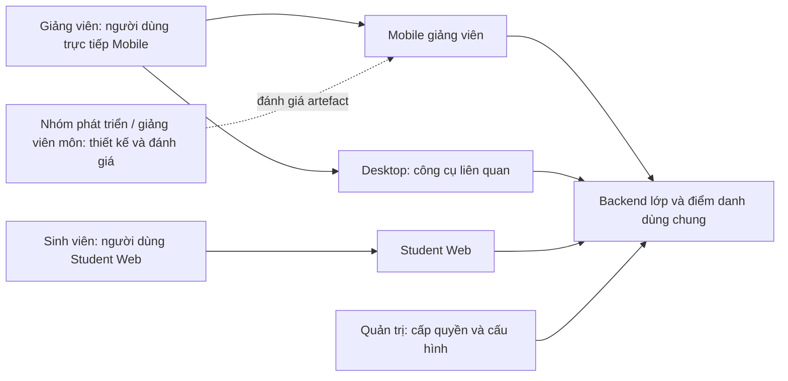

# Stakeholder, brainstorming và affinity

## Stakeholder / User Map

Mô hình chức năng lấy từ E01/E03; vai trò tổ chức cần xác nhận. Sinh viên ảnh hưởng vào dữ liệu phiên nhưng không cần persona workspace Mobile trong phạm vi này. Provider Firebase/Google/Apps Script là phụ thuộc kỹ thuật, không phải persona. Cần chủ động tìm người dùng chữ lớn, ít quen app hoặc gặp mạng kém; không coi họ là nhóm ngoài phạm vi chỉ vì khó tuyển.

## Affinity Board ban đầu

**Bản desk synthesis, chưa phải kết quả workshop hay phỏng vấn.** Mỗi ghi chú có nguồn hoặc nhãn A. Không có ảnh workshop để đính kèm.

| Card | Nội dung một ý | Nguồn / trạng thái | Cụm |
|---|---|---|---|
| C01 | Chủ dự án yêu cầu giảm chữ trên Hôm nay | E07, Reported | G1: nhận diện nhanh |
| C02 | UI đã có lớp/môn/slot/phòng để đối chiếu buổi | E02, Observed/source | G1 |
| C03 | Thu gọn có thể che thông tin cần tìm | A05, Assumed | G1 |
| C04 | Form giữ lý do sau lỗi ghi | E04, Observed/source | G2: kiểm soát kết quả |
| C05 | Có thể không biết nên gửi lại hay đối chiếu sau timeout | A02, Assumed | G2 |
| C06 | QR hết hạn khác với chốt phiên | E03, Observed/source | G2 |
| C07 | Sổ tay gắn theo đúng buổi | E05, Observed/source | G3: tiếp nối công việc |
| C08 | Có thể cần tìm phần chưa dạy xong ở buổi sau | A03, Assumed | G3 |
| C09 | Ghi chú hiện chưa chuyển sang thiết bị khác | E05, Observed/source | G3 |
| C10 | Mạng/một tay có thể ảnh hưởng mọi luồng | A04, Assumed | G4: điều kiện sử dụng |
| C11 | Nhãn gọn cần được thử với người ít quen app | A05, Assumed | G4 |

G1 đề xuất P01, G2 đề xuất P02, G3 đề xuất P03. G4 là điều kiện xuyên persona. Các cụm không chứng minh có ba quần thể người dùng riêng biệt.

## Brainstorming log chuẩn bị

Ngày soạn 15/10/2026; người tham gia workshop: **chưa có**. Các lựa chọn dưới đây là phân tích sau khi sản phẩm đã tồn tại, không ghi lại như workshop lịch sử.

| Ý tưởng | Quyết định nháp | Căn cứ và câu hỏi |
|---|---|---|
| Giữ một persona chung “giảng viên” | Modify: tách ba giả thuyết hành vi để kiểm chứng | A07; một role có thể có nhiều bối cảnh |
| Dựng persona theo tuổi | Reject | Tuổi không chứng minh nhu cầu/thiết kế khác nhau |
| Thêm workspace sinh viên vào Mobile | Reject trong phạm vi hiện tại | E01; Student Web đã đảm nhiệm luồng đó |
| Giảm chữ và giữ trợ giúp theo yêu cầu | Accept để thử, chưa kết luận thành công | E07, A05; kiểm tra hiểu nhãn qua T01–T03 |
| Bỏ xác nhận/lý do để điểm danh nhanh hơn | Reject | E03/E04; hậu quả ghi sai và ràng buộc audit |
| Tuyên bố sổ tay giải quyết đa thiết bị | Reject | E05 cho thấy local-only |
| Bổ sung livestream/bảng viết/chat như ví dụ môn | Reject | Không có nguồn nhu cầu trong phạm vi này |

## Workshop nhóm dự kiến — 75 phút

1. 0–10: thống nhất problem statement, phạm vi Mobile và nguồn E/A.
2. 10–25: từng thành viên viết ghi chú độc lập về tình huống, công cụ đang dùng, rào cản; gắn nguồn hoặc Assumed.
3. 25–40: gom thẻ theo hành vi/mục tiêu; ghi các ý trái chiều.
4. 40–55: đối chiếu coverage, thử xóa từng persona và nêu quyết định UI nào bị mất.
5. 55–65: chọn câu hỏi nghiên cứu quan trọng nhất; không biểu quyết để biến giả định thành sự thật.
6. 65–75: giao người tuyển mẫu/điều phối/ghi chép và lịch thực hiện.

Đầu ra sau khi tổ chức: ảnh/bản export board có đồng thuận, danh sách thành viên, ngày giờ, card IDs, quyết định giữ/gộp/tách và backlog cập nhật. Hiện các mục này chưa được điền.

