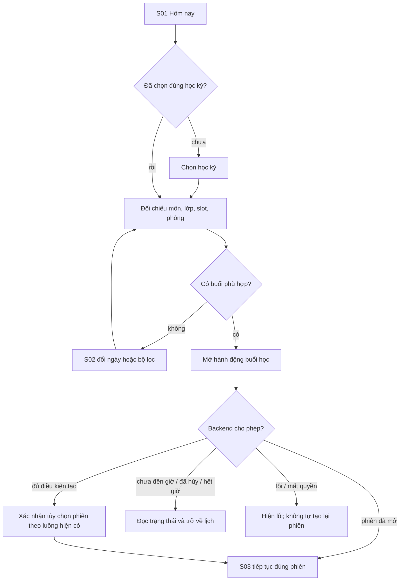
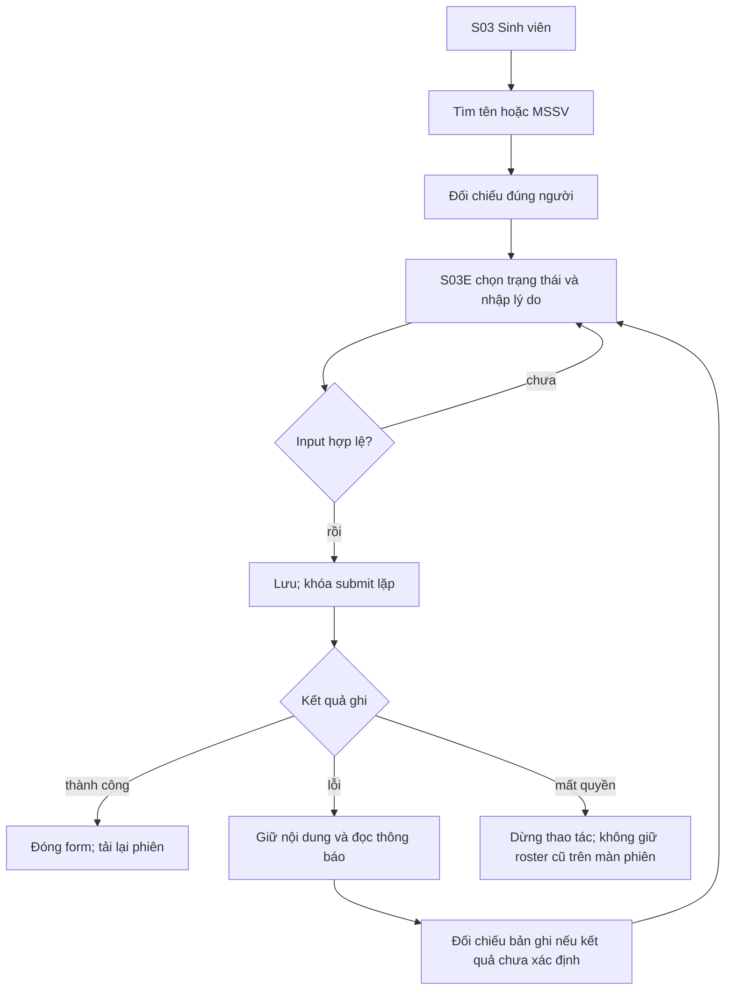
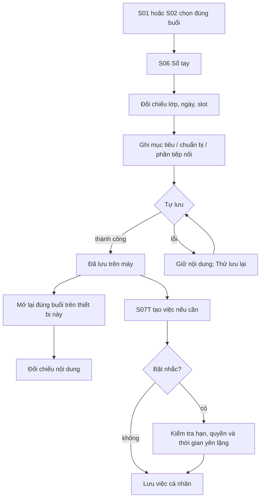

# Information Architecture và User Flows

Các flow mô tả source hiện tại ngày 15/10/2026, không xác nhận production đã chạy E2E. Persona/nhu cầu ở đầu mỗi flow vẫn là giả thuyết. Test người dùng phải dùng môi trường cô lập; không tạo hoặc sửa attendance thật để demo lỗi.

## IA và mã màn hình

```text
S00 Đăng nhập Google
└─ Shell: 4 tab, giữ trạng thái khi chuyển tab
   ├─ S01 Hôm nay → S03 phiên / S06 sổ tay / S07 trợ lý
   ├─ S02 Lịch dạy ngày-tuần → S03 / S06
   ├─ S04 Lớp học → S05 chi tiết lớp
   │  └─ Sinh viên / Điểm danh / Buổi học / Thống kê
   │     ├─ S03 Phiên: Mã QR | Sinh viên
   │     └─ S10 Công cụ lớp và nhập dữ liệu
   └─ S08 Cập nhật → S09 thư viện / chi tiết bài viết
S11 Tài khoản và giao diện
```

S03E là dialog sửa trong S03, không phải destination/tab mới. S07T là form việc cá nhân. S07R là tổng kết tuần. Mã màn ổn định để dùng trong ma trận và handoff, không phải số thứ tự route.

## F01 — Tìm đúng buổi và mở/tiếp tục phiên

**P01 → N01:** nhận diện đúng buổi với ít gián đoạn. Trigger: sắp vào lớp. Precondition: đã đăng nhập, có quyền lớp, dữ liệu học kỳ đã cấu hình.



Alternative: từ S04 → S05 → Buổi học hoặc S02. Recovery khi lỗi tải: cập nhật dữ liệu theo UI; khi ghi không rõ kết quả, kiểm tra phiên trước khi thử tiếp. Mở Hôm nay không tự tạo attendance session. Thành công: đúng lớp/slot và phiên; T01 đo nhận diện/điều hướng, Q04 kiểm side effect kỹ thuật.

## F02 — Điều chỉnh một sinh viên và xác nhận kết quả

**P02 → N02:** hiểu và kiểm soát thay đổi. Trigger: có một trường hợp cần đối chiếu. Precondition: lecturer có quyền phiên; roster được tải và UI cho sửa.



Không biến mọi lỗi mạng thành “chưa ghi”; response timeout có thể xảy ra sau khi backend đã nhận thao tác. Không gộp PRESENT/LATE/ABSENT/EXCUSED. Hủy/Back theo draft guard hiện có. QR hết hạn không tự mang nghĩa phiên đã chốt. T02 quan sát hiểu và phục hồi; Q01–Q03 đối chiếu source test.

## F03 — Ghi và tìm lại phần cần tiếp nối

**P03 → N03:** truy xuất đúng ghi chú qua nhiều buổi. Trigger: kết thúc/chuẩn bị một buổi dạy. Precondition: cùng tài khoản, trên cùng thiết bị.



Alternative: vào S07 từ nút Trợ lý để tìm ghi chú/việc. Sao chép phần tiếp nối chỉ dùng lớp/môn/học kỳ phù hợp theo source; không thay metadata buổi đích. Không hứa đồng bộ máy khác hoặc nhắc đúng giờ tuyệt đối. T03 đo việc tìm lại và hiểu lưu local; Q05/Q06 kiểm bảo toàn nội dung.

## Flow → Screen → Usability

| Flow | Màn trọng tâm | Nhiệm vụ | Phép đo |
|---|---|---|---|
| F01 | S01, S02, S03 | T01 | Thời gian định vị, chọn nhầm, trợ giúp |
| F02 | S03, S03E | T02 | Đúng người, lý do còn giữ, submit lặp, hiểu kết quả |
| F03 | S06, S07T | T03 | Thời gian, mở đúng buổi, nội dung khớp, hiểu nơi lưu |

Các mã Q ở [design-decisions](../design/design-decisions.md) là kiểm tra kỹ thuật; T ở [research-plan](research-plan.md) là phép thử người dùng chưa thực hiện.

